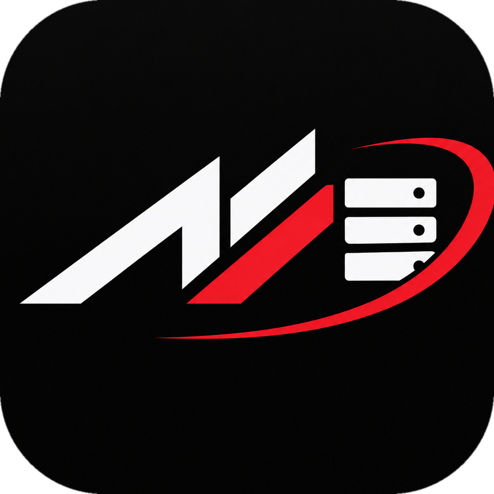
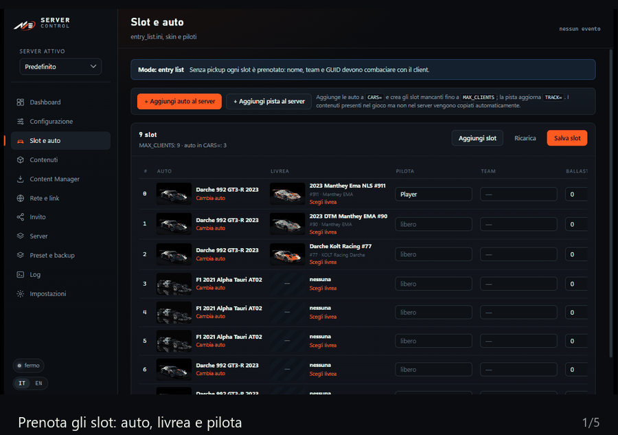
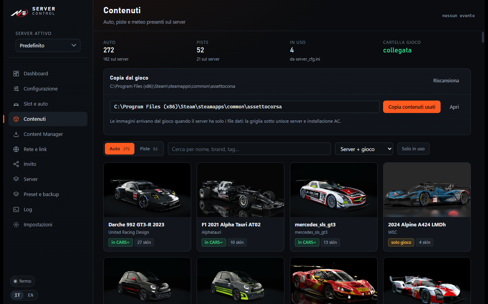
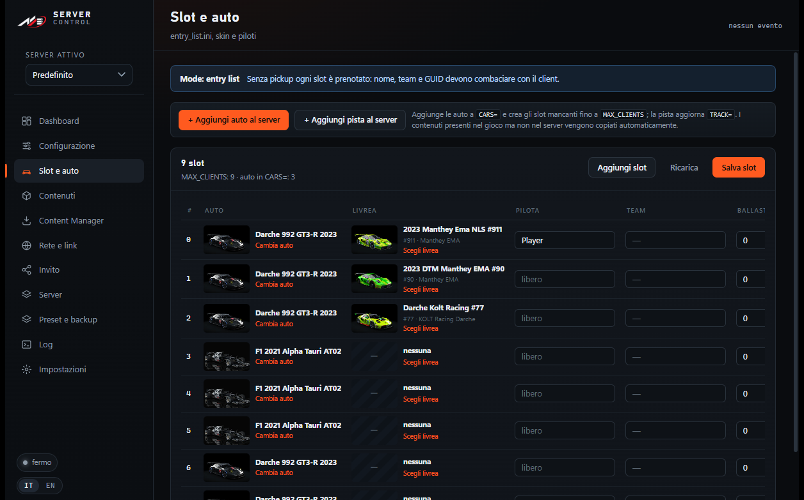
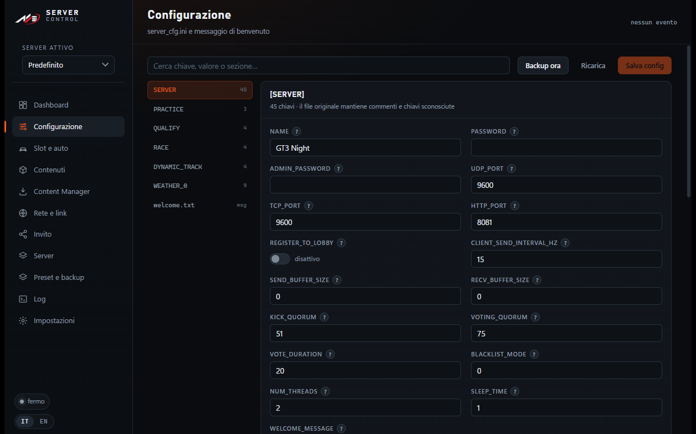
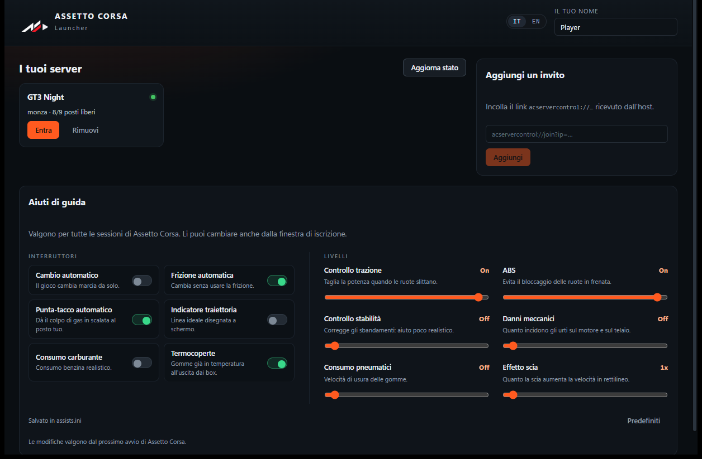
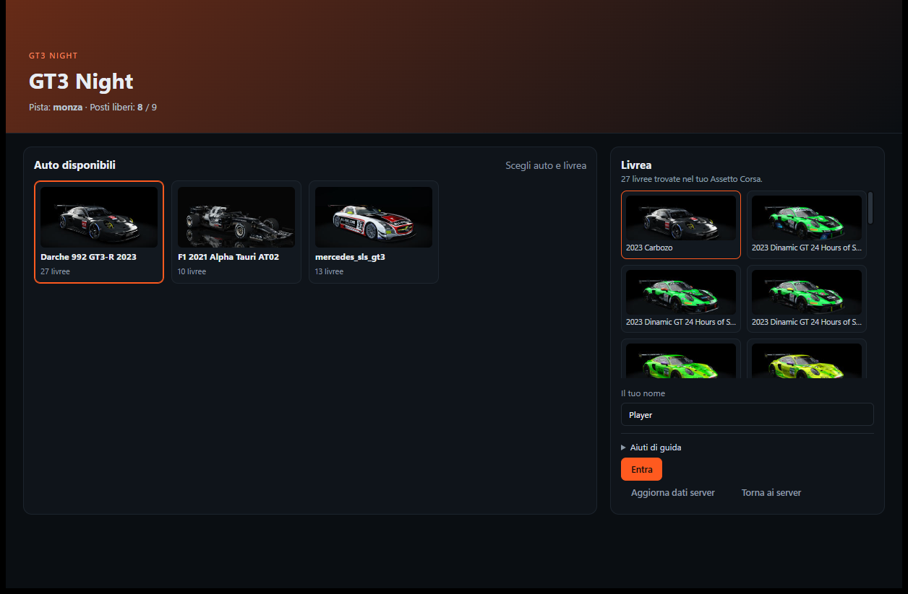

<p align="center">
  
  &nbsp;&nbsp;&nbsp;
  
</p>

<h1 align="center">AC Server Control</h1>

<p align="center">
  <b><a href="README-IT.md">Italiano</a></b> · <a href="README.md">English</a>
</p>

<p align="center">
  Pannello portable per gestire un server dedicato di Assetto Corsa su Windows,<br>
  con un launcher che porta gli amici in partita con un solo clic.<br>
  <sub>Tauri 2 · React + TypeScript · Rust · interfaccia IT/EN</sub>
</p>

<p align="center">
  <a href="https://github.com/terzastella/AC-Server-Manager/actions/workflows/ci.yml"></a>
  <a href="https://github.com/terzastella/AC-Server-Manager/releases/latest"></a>
  
  
  
</p>

---

## Cos'è

Due eseguibili, nessuna installazione:

| Eseguibile | A cosa serve |
|---|---|
| **ACServerControl.exe** | Gestisce il server: avvio/stop, `server_cfg.ini`, slot e livree, contenuti, porte, inviti, profili multipli, preset e backup, log live |
| **ACLauncher.exe** | Lo aprono gli amici: incollano il link d'invito, scelgono auto e livrea, prenotano lo slot e **entrano direttamente in partita** (scrive `race.ini` e avvia `acs.exe`, senza passare da Content Manager) |

Tutto vive nella stessa cartella del server: configurazioni, contenuti e log restano
in file leggibili (`cfg/*.ini`, `content/`, `logs/`), senza database né servizi esterni.

**Funzioni principali**

- Avvio, stop e riavvio del server con log live e stato in tempo reale
- Editor di `server_cfg.ini` e `entry_list.ini` che preserva ordine e commenti, con una spiegazione per ogni campo
- Slot con auto, livrea e pilota; prenotazione legata allo SteamID64 del giocatore
- Browser contenuti (auto, piste, meteo) con anteprime e copia dal gioco al server
- Lettura **in sola lettura** dei settings di Content Manager, import dei preset server
- Rete: IP rilevati, link `acmanager://`, QR code, controllo porte, regole firewall
- Invito con grafica personalizzata, token e prenotazione via HTTP API
- Profili multipli che condividono gli stessi contenuti (un solo `content/`)
- Preset, backup automatici, log delle sessioni precedenti
- Interfaccia **IT / EN** commutabile a caldo

## Demo



## Screenshot

| Manager · Contenuti | Manager · Slot e auto |
|---|---|
|  |  |

| Manager · Configurazione | Launcher · i tuoi server |
|---|---|
|  |  |

**La finestra d'ingresso** — l'amico sceglie auto, livrea e nome, poi entra in partita:



## Come funziona

```text
+- PC DI CHI OSPITA ---------------------------------------------+
|                                                                |
|  +---------------------+              +---------------------+  |
|  | ACServerControl.exe |              | acServer.exe        |  |
|  | manager + API       | <------->    | UDP/TCP 9600        |  |
|  | HTTP : 8082         |              | HTTP   8081         |  |
|  +---------------------+              +---------------------+  |
|             |                                    ^             |
|             v content/ . cfg/ . logs/            |             |
|                                                  |             |
|                                                  |             |
+--------------------------------------------------|-------------+
+- PC DEGLI AMICI -----------------------------------------------+
|                                                  |             |
|  +---------------------+   link + token          | partita     |
|  | ACLauncher.exe      |   GET  /api/server      |             |
|  | apre il link        |   POST /api/reserve     |             |
|  | prenota lo slot     |                         |             |
|  +---------------------+                         |             |
|             v                                    |             |
|     +-------------+                              |             |
|     | acs.exe     +------------------------------+             |
|     +-------------+                                            |
|                                                                |
+----------------------------------------------------------------+
```

In pratica:

1. L'host apre **ACServerControl.exe** e avvia `acServer.exe` (`UDP/TCP 9600`, `HTTP 8081`).
2. Il manager genera un link: `acservercontrol://join?ip=…&httpPort=8081&apiPort=8082&token=…`.
3. L'amico lo apre: **ACLauncher.exe** chiama `GET /api/server` e riceve nome, pista, auto e livree.
4. Sceglie auto, livrea e nome → `POST /api/reserve` → lo slot viene scritto in `entry_list.ini`.
5. Il launcher scrive `race.ini` (sezione `[REMOTE]`) e avvia `acs.exe`.
6. Assetto Corsa entra nel server, nello slot prenotato.

Il manager parla con il server su `HTTP_PORT` (default 8081) e pubblica una piccola
API per il launcher su `API_PORT` (default 8082). L'API ascolta su `127.0.0.1` per
impostazione predefinita — l'indirizzo della VPN si sceglie dalla pagina Invito — e
ogni richiesta porta il token nell'header `Authorization: Bearer`, con limite di
richieste per IP.

## Requisiti

- Windows 10/11 x64 con **WebView2 Runtime** (presente di serie su Windows 11)
- **Assetto Corsa** installato da Steam, con i file del server dedicato
  (`acServer.exe` e `content/`)
- *Opzionale*: Content Manager, letto in sola lettura per importare settings e preset
- Per giocare in rete: Hamachi, Radmin VPN, ZeroTier, Tailscale o port forwarding

## Download e integrità

Gli eseguibili pronti sono allegati alla [release più recente](https://github.com/terzastella/AC-Server-Manager/releases/latest):
`ACServerControl.exe`, `ACLauncher.exe` e `SHA256SUMS.txt`.

```powershell
# verifica del download
Get-FileHash .\ACServerControl.exe -Algorithm SHA256
Get-FileHash .\ACLauncher.exe -Algorithm SHA256
# confronta con gli hash in SHA256SUMS.txt
```

Gli eseguibili **non sono firmati**, quindi al primo avvio Windows SmartScreen può
mostrare un avviso ("Windows ha protetto il PC"): dopo aver controllato l'hash scegli
*Ulteriori informazioni → Esegui comunque*. Il progetto non ha ancora un certificato
di firma; il codice è pubblico e la build è riproducibile con `build.ps1`.

## Compilare da sorgente

```powershell
# dipendenze
cd app
npm install

# build portable (produce dist\ACServerControl.exe e dist\ACLauncher.exe)
powershell -NoProfile -ExecutionPolicy Bypass -File .\build.ps1
```

Servono Node.js 20+, Rust stabile e Visual Studio Build Tools (C++).
Lo script riscrive i percorsi di build, così i binari non contengono il tuo
profilo utente (`C:\Users\<nome>\...`).

Gli asset del brand si rigenerano con `python docs\brand\generate-assets.py` (icone)
e `python docs\brand\cutout.py` (marchio senza sfondo per l'interfaccia).

## Struttura

```
app/                     Tauri: frontend React (src/) e backend Rust (src-tauri/src/)
  src/i18n/              dizionari IT/EN, un file per area funzionale
  src/pages/             Dashboard, Configurazione, Slot, Contenuti, CM, Rete, Invito...
  src-tauri/src/         comandi, API HTTP, ini, profili, slot, contenuti, messaggi
docs/brand/              loghi (PNG/ICO) e script che li generano
docs/img/                screenshot per i README
docs/release-notes/      note di release, un file per tag
```

## Internazionalizzazione

L'interfaccia è disponibile in **italiano** e **inglese**: si cambia dalle
Impostazioni del manager o dal selettore `IT / EN` nel launcher, e la scelta vale
per entrambi (è salvata in `settings.json`).

Le traduzioni stanno in `app/src/i18n/namespaces/*.ts`: ogni file espone `it` ed `en`
con le stesse chiavi, quindi una traduzione mancante viene segnalata da TypeScript
in compilazione. I messaggi generati dal backend Rust sono bilingui in
`app/src-tauri/src/messages.rs`.

Non vengono tradotti i dati di Assetto Corsa (nomi di auto, piste, livree), le
chiavi dei file `.ini` e il contenuto dei log del server.

## Limiti noti

- **Le prenotazioni valgono dal prossimo avvio**: Assetto Corsa legge `entry_list.ini`
  solo all'avvio, quindi una prenotazione fatta a server acceso ha effetto dopo un
  riavvio (il pannello te lo dice).
- **Le prenotazioni sono identificate dallo SteamID64**, quindi due persone con lo
  stesso nome ottengono slot diversi. Uno slot creato a mano con il solo nome e
  senza GUID viene adottato dal primo giocatore che si presenta con quel nome:
  è la regola di compatibilità per le prenotazioni fatte prima della 1.0.2.
- **Content Manager è opzionale e in sola lettura**: l'import dei settings funziona, ma
  nulla viene mai scritto su `Values.data`.
- **I contenuti devono già esistere** sul server: l'app copia e verifica auto, piste e
  meteo, ma non scarica mod.
- **Solo Windows** (WebView2): nessuna build Linux o macOS.
- **Elenco delle schede di rete solo IPv4**: gli inviti usano IPv4, perché il server
  di Assetto Corsa e `race.ini` non gestiscono IPv6 in modo affidabile. Il campo di
  bind dell'API accetta comunque un indirizzo IPv6 scritto a mano.
- **Nessuna firma del codice**, vedi *Download e integrità*.

## Sicurezza

- Tutto gira in locale: nessuna telemetria, nessun servizio cloud, nessun account.
- L'API delle prenotazioni ascolta su `127.0.0.1` a meno che tu non scelga un'altra
  interfaccia, ed è protetta da un token casuale inviato nell'header
  `Authorization: Bearer` (mai nell'URL), con limite di richieste per IP; espone solo
  ciò che serve al launcher (informazioni sul server e prenotazione dello slot).
- Password admin e token stanno in `settings.json` e `cfg/server_cfg.ini`, esclusi
  dal repository.
- L'API deve essere raggiungibile solo dai tuoi amici: tienila dentro la VPN, oppure
  apri la porta deliberatamente.
- Come segnalare un problema di sicurezza: [SECURITY.md](SECURITY.md).

## Community

- [CONTRIBUTING.md](CONTRIBUTING.md) — come compilare, testare e proporre una modifica
- [CODE_OF_CONDUCT.md](CODE_OF_CONDUCT.md) — Contributor Covenant 2.1
- [SECURITY.md](SECURITY.md) — policy di sicurezza e segnalazioni
- Bug e proposte: usa i template nella scheda Issues
- Changelog: [CHANGELOG.md](CHANGELOG.md)

## Cosa non è nel repository

Il repo contiene sorgenti, documentazione e immagini. Non contiene binari del gioco,
contenuti né configurazioni personali.

| Escluso | Perché |
|---|---|
| `acServer.exe`, `acServerManager.exe` | binari di Assetto Corsa, non ridistribuibili |
| `content/`, `system/` | auto, piste e DLL del server |
| `cfg/`, `profiles/`, `presets/`, `setups/`, `backups/`, `logs/` | dati locali (password admin, nomi piloti) |
| `dist/`, `node_modules/`, `target/` | build e dipendenze |

Dopo un clone servono `acServer.exe` e i contenuti dalla propria installazione di
Assetto Corsa; il resto lo crea il pannello. Gli eseguibili già compilati sono
allegati alla release più recente.

## Licenza

[MIT](LICENSE) © 2026 terzastella

Assetto Corsa, Content Manager e i relativi contenuti appartengono ai rispettivi
proprietari. Questo progetto non è affiliato a Kunos Simulazioni. Vedi [NOTICE.md](NOTICE.md).

---

<p align="center">
  <sub>Progetto personale, senza affiliazione a Kunos Simulazioni o Assetto Corsa.</sub>
</p>
