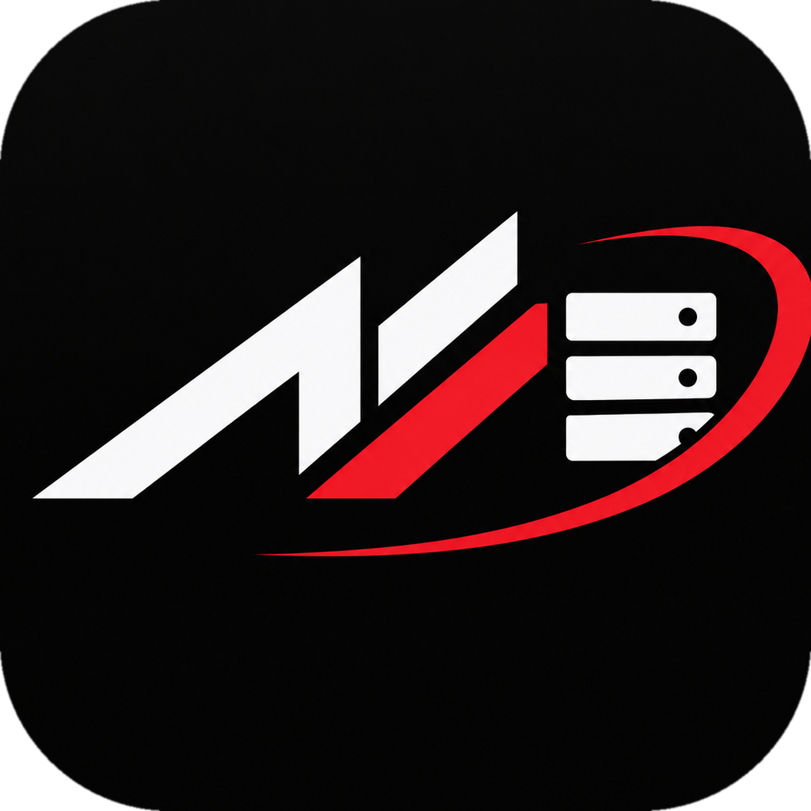
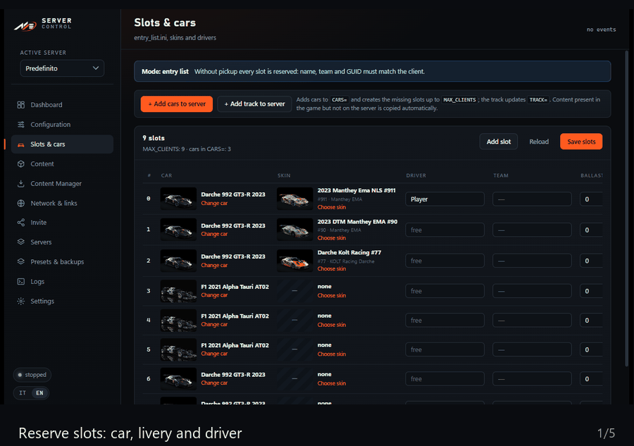
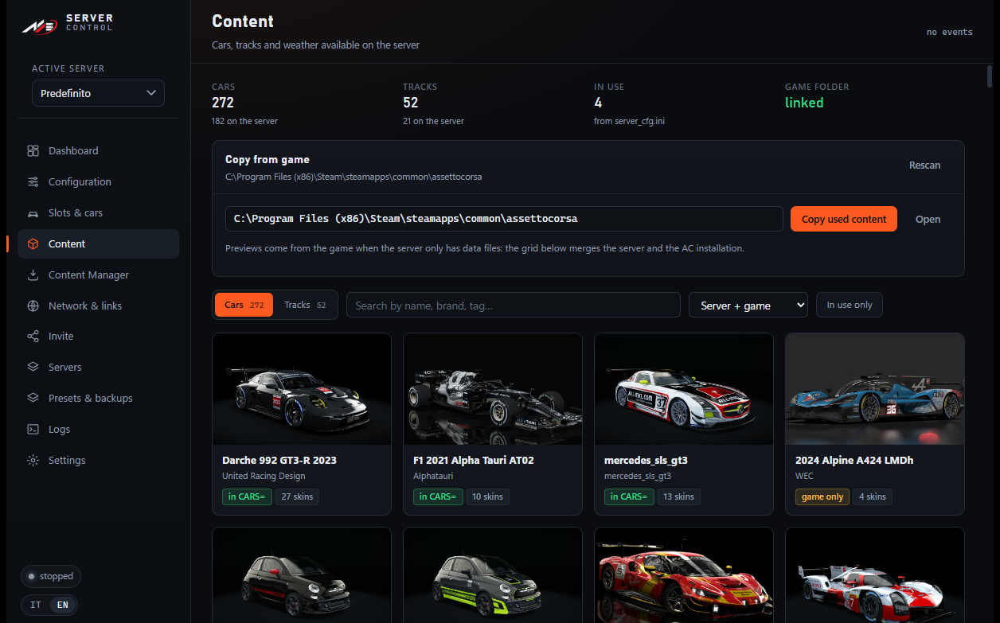
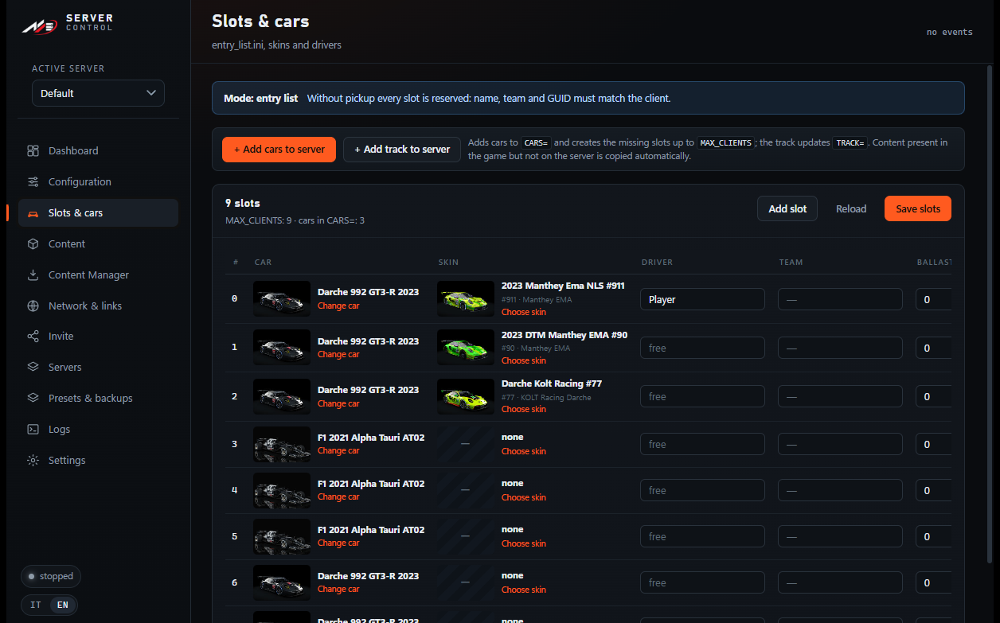
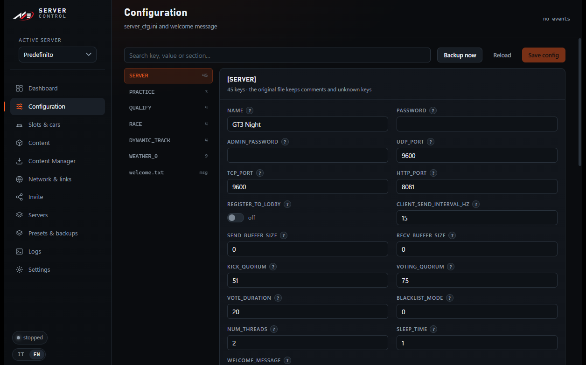
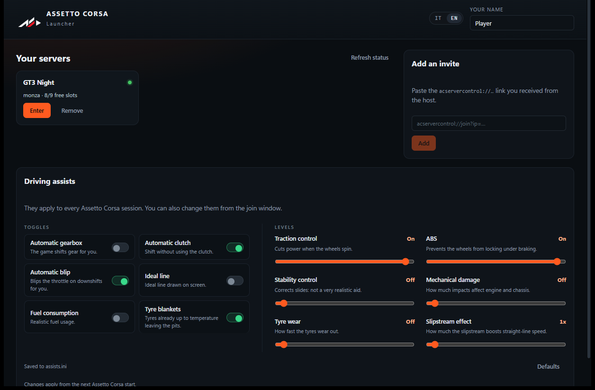
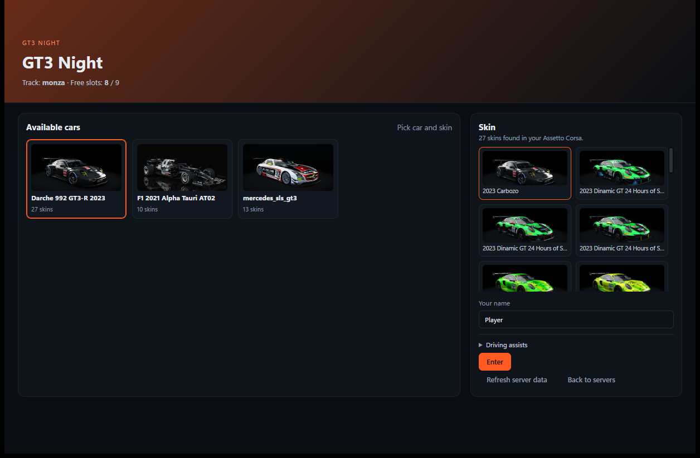

<p align="center">
  
  &nbsp;&nbsp;&nbsp;
  
</p>

<h1 align="center">AC Server Control</h1>

<p align="center">
  <a href="README-IT.md">Italiano</a> · <b><a href="README.md">English</a></b>
</p>

<p align="center">
  Portable manager for a Windows-hosted Assetto Corsa dedicated server,<br>
  with a launcher that drops your friends straight into the race.<br>
  <sub>Tauri 2 · React + TypeScript · Rust · IT/EN interface</sub>
</p>

<p align="center">
  <a href="https://github.com/terzastella/AC-Server-Manager/actions/workflows/ci.yml"></a>
  <a href="https://github.com/terzastella/AC-Server-Manager/releases/latest"></a>
  
  
  
</p>

---

## What it is

Two executables, no installation:

| Executable | What it does |
|---|---|
| **ACServerControl.exe** | Runs the server: start/stop, `server_cfg.ini`, slots and skins, content, ports, invites, multiple server profiles, presets and backups, live logs |
| **ACLauncher.exe** | Sent to friends: they paste the invite link, pick car and skin, book their slot and **go straight into the game** (writes `race.ini` and starts `acs.exe`, no Content Manager needed) |

Everything lives next to the server itself: configuration, content and logs stay in
plain files (`cfg/*.ini`, `content/`, `logs/`) — no database, no external service.

**Main features**

- Start, stop and restart the server with live logs and real-time status
- `server_cfg.ini` and `entry_list.ini` editor that preserves order and comments, with an explanation for every field
- Slots with car, skin and driver; soft booking by driver name
- Content browser (cars, tracks, weather) with previews and copy from the game to the server
- **Read-only** access to Content Manager settings, import of server presets
- Network: detected IPs, `acmanager://` links, QR code, port checks, firewall rules
- Branded invite page, token and HTTP booking API
- Multiple server profiles sharing the same content (one `content/` folder)
- Presets, automatic backups, logs of previous sessions
- **Italian / English** interface, switchable on the fly

## Demo



## Screenshots

| Manager · Content | Manager · Slots & cars |
|---|---|
|  |  |

| Manager · Configuration | Launcher · your servers |
|---|---|
|  |  |

**The join window** — friends pick car, skin and driver name, then go straight into the race:



## How it works

```text
+- HOST PC ------------------------------------------------------+
|                                                                |
|  +---------------------+              +---------------------+  |
|  | ACServerControl.exe |              | acServer.exe        |  |
|  | manager + API       | <------->    | UDP/TCP 9600        |  |
|  | HTTP : 8082         |              | HTTP   8081         |  |
|  +---------------------+              +---------------------+  |
|             |                                    ^             |
|             v content/ . cfg/ . logs/            |             |
|                                                  |             |
|                                                  |             |
+--------------------------------------------------|-------------+
+- FRIENDS' PC --------------------------------------------------+
|                                                  |             |
|  +---------------------+   invite link + token   | race        |
|  | ACLauncher.exe      |   GET  /api/server      |             |
|  | opens the link      |   POST /api/reserve     |             |
|  | books the slot      |                         |             |
|  +---------------------+                         |             |
|             v                                    |             |
|     +-------------+                              |             |
|     | acs.exe     +------------------------------+             |
|     +-------------+                                            |
|                                                                |
+----------------------------------------------------------------+
```

Step by step:

1. The host opens **ACServerControl.exe** and starts `acServer.exe` (`UDP/TCP 9600`, `HTTP 8081`).
2. The manager builds a link: `acservercontrol://join?ip=…&httpPort=8081&apiPort=8082&token=…`.
3. A friend opens it: **ACLauncher.exe** calls `GET /api/server` and gets name, track, cars and skins.
4. They pick car, skin and name → `POST /api/reserve` → the slot is written into `entry_list.ini`.
5. The launcher writes `race.ini` (the `[REMOTE]` section) and starts `acs.exe`.
6. Assetto Corsa joins the server, in the booked slot.

The manager talks to the server on `HTTP_PORT` (default 8081) and exposes a small
API for the launcher on `API_PORT` (default 8082), protected by a token with
per-IP rate limiting.

## Requirements

- Windows 10/11 x64 with **WebView2 Runtime** (bundled with Windows 11)
- **Assetto Corsa** installed from Steam, with the dedicated server files
  (`acServer.exe` and `content/`)
- *Optional*: Content Manager, read-only, to import settings and presets
- To play over the internet: Hamachi, Radmin VPN, ZeroTier, Tailscale or port forwarding

## Downloads and integrity

Prebuilt executables are attached to the [latest release](https://github.com/terzastella/AC-Server-Manager/releases/latest):
`ACServerControl.exe`, `ACLauncher.exe` and `SHA256SUMS.txt`.

```powershell
# verify the download
Get-FileHash .\ACServerControl.exe -Algorithm SHA256
Get-FileHash .\ACLauncher.exe -Algorithm SHA256
# compare with the hashes in SHA256SUMS.txt
```

The executables are **not code-signed**, so the first launch may show a Windows
SmartScreen warning ("Windows protected your PC"): choose *More info → Run anyway*
after checking the hash. A code signing certificate is not available for this
project yet; the source is public and the build is reproducible with `build.ps1`.

## Build from source

```powershell
# dependencies
cd app
npm install

# portable build (produces dist\ACServerControl.exe and dist\ACLauncher.exe)
powershell -NoProfile -ExecutionPolicy Bypass -File .\build.ps1
```

You need Node.js 20+, a stable Rust toolchain and Visual Studio Build Tools (C++).

Brand assets are regenerated with `python docs\brand\generate-assets.py` (icons)
and `python docs\brand\cutout.py` (background-free mark for the interface).

## Layout

```
app/                     Tauri: React frontend (src/) and Rust backend (src-tauri/src/)
  src/i18n/              IT/EN dictionaries, one file per feature area
  src/pages/             Dashboard, Configuration, Slots, Content, CM, Network, Invite...
  src-tauri/src/         commands, HTTP API, ini, profiles, slots, content, messages
docs/brand/              logos (PNG/ICO) and the scripts that generate them
docs/img/                screenshots used by the READMEs
```

## Internationalisation

The interface is available in **Italian** and **English**: switch it in the manager's
Settings or with the `IT / EN` selector in the launcher. The choice applies to both
(and is stored in `settings.json`).

Translations live in `app/src/i18n/namespaces/*.ts`: every file exposes `it` and `en`
with the same keys, so a missing translation is a TypeScript compile error. Messages
produced by the Rust backend are bilingual in `app/src-tauri/src/messages.rs`.

Assetto Corsa data (car, track and skin names), `.ini` keys and the server log
content are intentionally not translated.

## Known limitations

- **Bookings apply from the next server start**: Assetto Corsa reads `entry_list.ini`
  only at startup, so a booking made while the server is running takes effect after a
  restart (the panel tells you).
- **Slot locking is by driver name**, not a hard GUID lock: two people typing the same
  name would fight over the same slot.
- **Content Manager is optional and read-only**: importing settings works, but nothing
  is ever written back to `Values.data`.
- **Content must already exist** on the server: the app copies and checks cars, tracks
  and weather, but never downloads mods.
- **Windows only** (WebView2): no Linux or macOS build.
- **No code signing** yet, see *Downloads and integrity*.

## Security

- Runs locally: no telemetry, no cloud service, no external account.
- The booking API is protected by a random token included in the invite link, rate
  limited per IP, and only exposes what the launcher needs (server info, slot booking).
- Admin password and invite tokens live in `settings.json` and `cfg/server_cfg.ini`,
  both excluded from the repository.
- The booking API is meant to be reachable by your friends only: keep it inside your
  VPN, or forward the port deliberately.
- How to report a vulnerability: see [SECURITY.md](SECURITY.md).

## Community

- [CONTRIBUTING.md](CONTRIBUTING.md) — how to build, test and send a change
- [CODE_OF_CONDUCT.md](CODE_OF_CONDUCT.md) — Contributor Covenant 2.1
- [SECURITY.md](SECURITY.md) — security policy and reporting
- Issues and feature requests: use the templates in the Issues tab
- Changelog: [CHANGELOG.md](CHANGELOG.md)

## What is not in the repository

The repo contains sources, documentation and images. It does not contain game
binaries, content or personal configuration.

| Excluded | Why |
|---|---|
| `acServer.exe`, `acServerManager.exe` | Assetto Corsa binaries, not redistributable |
| `content/`, `system/` | cars, tracks and server DLLs |
| `cfg/`, `profiles/`, `presets/`, `setups/`, `backups/`, `logs/` | local data (admin password, driver names) |
| `dist/`, `node_modules/`, `target/` | builds and dependencies |

After cloning you still need `acServer.exe` and the content from your own Assetto
Corsa installation; everything else is created by the app. Prebuilt executables are
attached to the latest release.

## License

[MIT](LICENSE) © 2026 terzastella

Assetto Corsa, Content Manager and their assets belong to their respective owners.
This project is not affiliated with Kunos Simulazioni.

---

<p align="center">
  <sub>Personal project, not affiliated with Kunos Simulazioni or Assetto Corsa.</sub>
</p>
