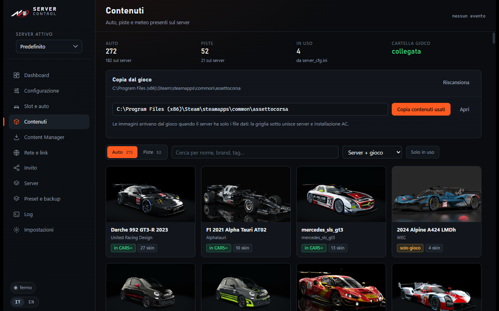
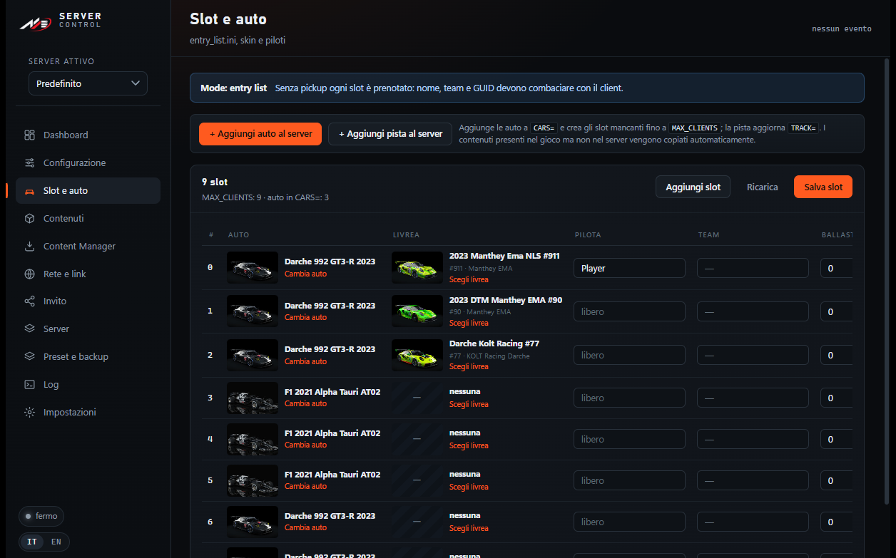
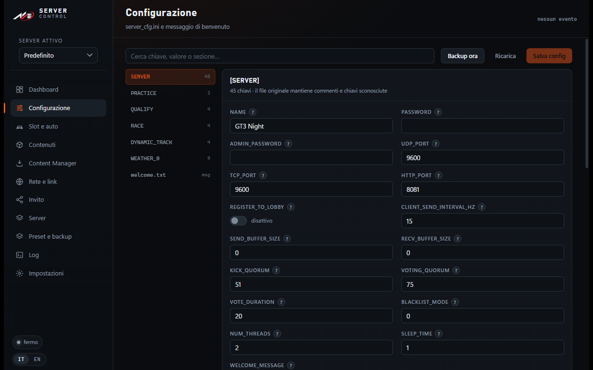
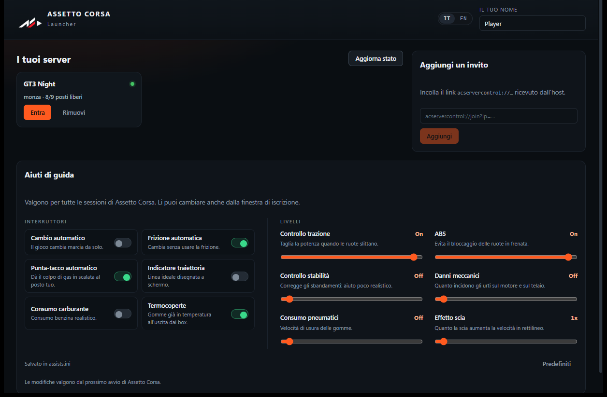

<p align="center">
  
  &nbsp;&nbsp;&nbsp;
  
</p>

<h1 align="center">AC Server Control</h1>

<p align="center">
  Pannello portable per gestire un server dedicato di Assetto Corsa su Windows,<br>
  con un launcher dedicato agli amici che devono solo cliccare un link.<br>
  <sub>Interfaccia in italiano e inglese · Tauri 2 · React + TypeScript · Rust</sub>
</p>

---

## Cos'è

Due eseguibili, nessuna installazione:

| Eseguibile | A cosa serve |
|---|---|
| **ACServerControl.exe** | Gestisce il server: avvio/stop, `server_cfg.ini`, slot e livree, contenuti, porte, inviti, profili multipli, preset e backup, log live |
| **ACLauncher.exe** | Lo aprono gli amici: incollano il link d'invito, scelgono auto e livrea, prenotano lo slot e **entrano direttamente in partita** (scrive `race.ini` e avvia `acs.exe`, senza passare da Content Manager) |

Tutto vive nella stessa cartella del server: configurazioni, contenuti e log restano
in file leggibili (`cfg/*.ini`, `content/`, `logs/`), senza database né servizi esterni.

**Funzioni principali**

- Avvio, stop e riavvio del server con log live e stato in tempo reale
- Editor di `server_cfg.ini` e `entry_list.ini` che preserva ordine e commenti, con una spiegazione per ogni campo
- Slot con auto, livrea e pilota; prenotazione "soft" per nome guidatore
- Browser contenuti (auto, piste, meteo) con anteprime e copia dal gioco al server
- Lettura **in sola lettura** dei settings di Content Manager, import dei preset server
- Rete: IP rilevati, link `acmanager://`, QR code, controllo porte, regole firewall
- Invito con grafica personalizzata, token e prenotazione via HTTP API
- Profili multipli che condividono gli stessi contenuti (un solo `content/`)
- Preset, backup automatici, log delle sessioni precedenti
- Interfaccia **IT / EN** commutabile a caldo

## Screenshot

| Contenuti | Slot e auto |
|---|---|
|  |  |

| Configurazione | Launcher per gli amici |
|---|---|
|  |  |

## Come funziona

```text
+- PC DI CHI OSPITA ---------------------------------------------+
|                                                                |
|  +---------------------+              +---------------------+  |
|  | ACServerControl.exe |              | acServer.exe        |  |
|  | manager + API       | <------->    | UDP/TCP 9600        |  |
|  | HTTP : 8082         |              | HTTP   8081         |  |
|  +---------------------+              +---------------------+  |
|             |                                    ^             |
|             v content/ . cfg/ . logs/            |             |
|                                                  |             |
|                                                  |             |
+--------------------------------------------------|-------------+
+- PC DEGLI AMICI -----------------------------------------------+
|                                                  |             |
|  +---------------------+   link + token          | partita     |
|  | ACLauncher.exe      |   GET  /api/server      |             |
|  | apre il link        |   POST /api/reserve     |             |
|  | prenota lo slot     |                         |             |
|  +---------------------+                         |             |
|             v                                    |             |
|     +-------------+                              |             |
|     | acs.exe     +------------------------------+             |
|     +-------------+                                            |
|                                                                |
+----------------------------------------------------------------+
```

In pratica:

1. L'host apre **ACServerControl.exe** e avvia `acServer.exe` (`UDP/TCP 9600`, `HTTP 8081`).
2. Il manager genera un link: `acservercontrol://join?ip=…&httpPort=8081&apiPort=8082&token=…`.
3. L'amico lo apre: **ACLauncher.exe** chiama `GET /api/server` e riceve nome, pista, auto e livree.
4. Sceglie auto, livrea e nome → `POST /api/reserve` → lo slot viene scritto in `entry_list.ini`.
5. Il launcher scrive `race.ini` (sezione `[REMOTE]`) e avvia `acs.exe`.
6. Assetto Corsa entra nel server, nello slot prenotato.

Il manager parla con il server su `HTTP_PORT` (default 8081) e pubblica una piccola
API per il launcher su `API_PORT` (default 8082), protetta da token con limite di
richieste per IP.

## Requisiti

- Windows 10/11 x64 con **WebView2 Runtime** (presente di serie su Windows 11)
- **Assetto Corsa** installato da Steam, con i file del server dedicato
  (`acServer.exe` e `content/`)
- *Opzionale*: Content Manager, letto in sola lettura per importare settings e preset
- Per giocare in rete: Hamachi, Radmin VPN, ZeroTier, Tailscale o port forwarding

## Compilare da sorgente

```powershell
# dipendenze
cd app
npm install

# build portable (produce dist\ACServerControl.exe e dist\ACLauncher.exe)
powershell -NoProfile -ExecutionPolicy Bypass -File .\build.ps1
```

Servono Node.js 20+, Rust stabile e Visual Studio Build Tools (C++).
Gli asset del logo si rigenerano con `docs\brand\generate-brand.ps1`.

## Struttura

```
app/                     Tauri: frontend React (src/) e backend Rust (src-tauri/src/)
  src/i18n/              dizionari IT/EN, un file per area funzionale
  src/pages/             Dashboard, Configurazione, Slot, Contenuti, CM, Rete, Invito...
  src-tauri/src/         comandi, API HTTP, ini, profili, slot, contenuti, messaggi
docs/brand/              loghi (SVG/PNG/ICO) e generatore
docs/img/                screenshot per questo README
```

## Internazionalizzazione

L'interfaccia è disponibile in **italiano** e **inglese**: si cambia dalle
Impostazioni del manager o dal selettore `IT / EN` nel launcher, e la scelta vale
per entrambi (è salvata in `settings.json`).

Le traduzioni stanno in `app/src/i18n/namespaces/*.ts`: ogni file espone `it` ed `en`
con le stesse chiavi, quindi una traduzione mancante viene segnalata da TypeScript
in compilazione. I messaggi generati dal backend Rust sono bilingui in
`app/src-tauri/src/messages.rs`.

Non vengono tradotti i dati di Assetto Corsa (nomi di auto, piste, livree), le
chiavi dei file `.ini` e il contenuto dei log del server.

## Cosa non è nel repository

Il repo contiene solo il codice: niente binari del gioco, contenuti o configurazioni
personali.

| Escluso | Perché |
|---|---|
| `acServer.exe`, `acServerManager.exe` | binari di Assetto Corsa, non ridistribuibili |
| `content/`, `system/` | auto, piste e DLL del server |
| `cfg/`, `profiles/`, `presets/`, `setups/`, `backups/`, `logs/` | dati locali (password admin, nomi piloti) |
| `dist/`, `node_modules/`, `target/` | build e dipendenze |

Dopo un clone servono quindi `acServer.exe` e i contenuti dalla propria installazione
di Assetto Corsa; il resto lo crea il pannello.

## Privacy

- Nessuna telemetria, nessun servizio cloud: tutto gira in locale.
- L'API del launcher ascolta in rete per permettere le prenotazioni, è protetta da
  token e accetta richieste solo dagli indirizzi previsti.
- Le credenziali admin del server e i token d'invito stanno in `settings.json` e
  `cfg/server_cfg.ini`, che non vengono versionati.

---

## English

**AC Server Control** is a portable Windows toolbox for an Assetto Corsa dedicated
server, plus a launcher for friends.

- Manager: start/stop the server, edit `server_cfg.ini` and `entry_list.ini` losslessly,
  manage slots (car, skin, driver), browse content, read Content Manager settings
  read-only, handle ports and firewall, build branded invite links, keep multiple
  server profiles sharing the same content, presets and backups, live logs.
- Launcher: friends open an invite link, pick car and skin, book their slot and go
  straight into the game — it writes the `[REMOTE]` section of `race.ini` and starts
  `acs.exe`, no Content Manager involved.
- UI in **Italian and English** (switch in Settings or from the launcher, stored in
  `settings.json`).
- Requirements: Windows 10/11, WebView2, Assetto Corsa with the dedicated server files.
  Build with `npm install` then `build.ps1` inside `app/`.
- The repository ships source only: game binaries, content and personal
  configurations are not included.

---

<p align="center">
  <sub>Progetto personale, senza affiliazione a Kunos Simulazioni o Assetto Corsa.</sub>
</p>
